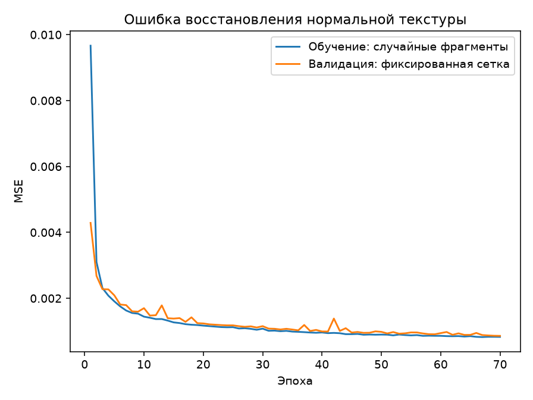
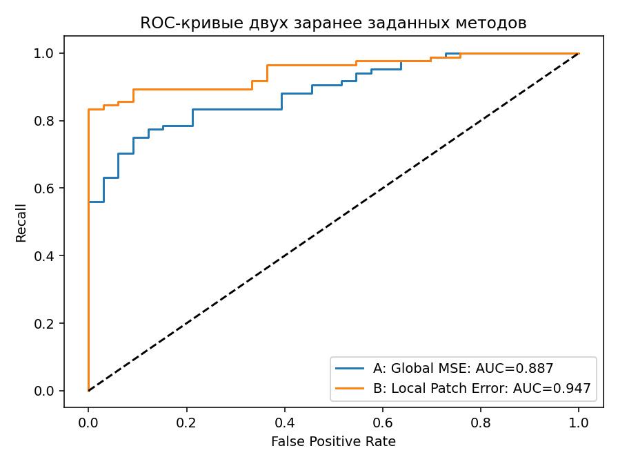
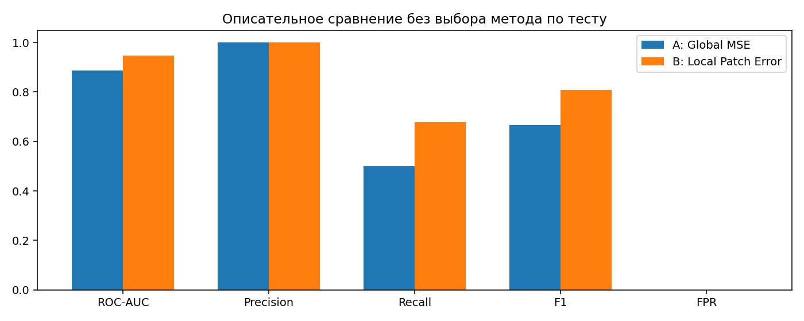
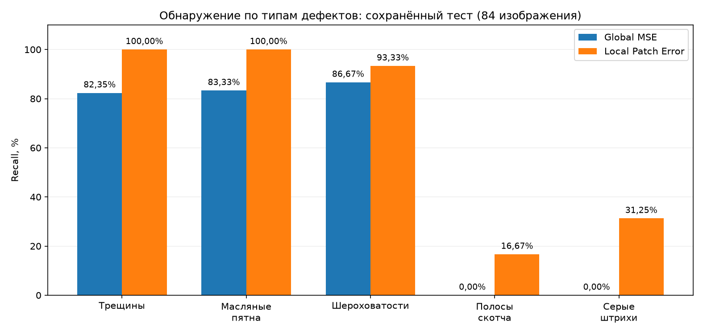
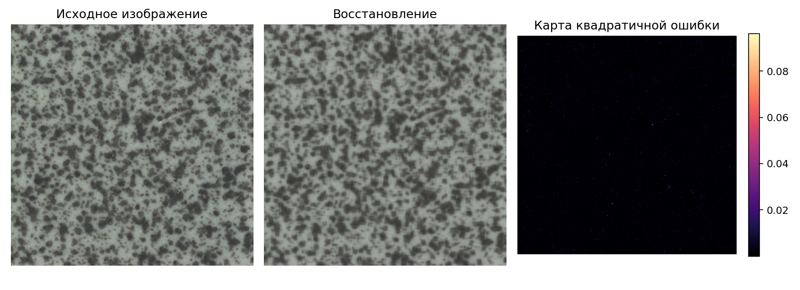
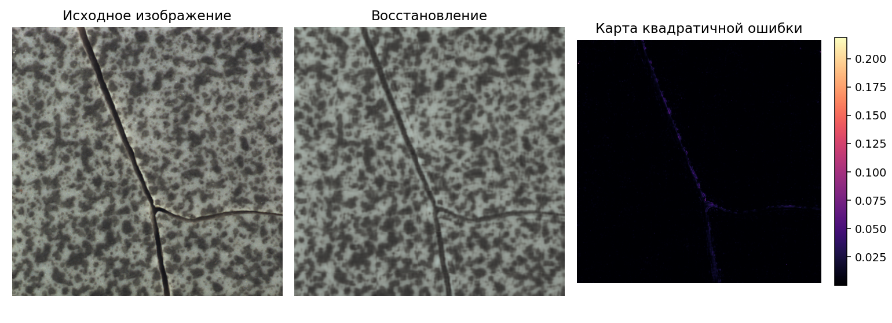
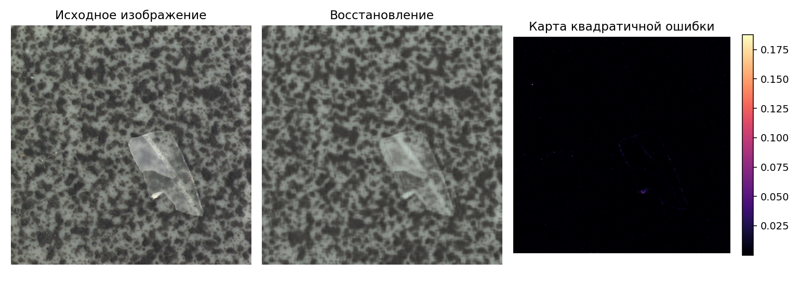
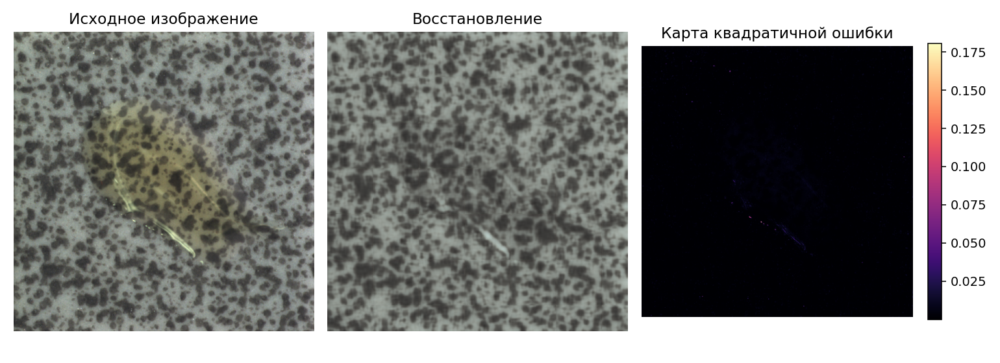

# Обнаружение дефектов текстуры с помощью автоэнкодера

Небольшой учебный проект по теории искусственных нейронных сетей. Свёрточный автоэнкодер обучается восстанавливать исправную текстуру плитки. По ошибке восстановления сравниваются два способа обнаружения дефектов: Global MSE и Local Patch Error.

## Технологии

Python 3.10+, PyTorch, NumPy, Pillow, scikit-learn и Matplotlib. Обучение и оценка работают на CPU, CUDA не требуется.

## Датасет

Сначала я попробовал небольшой набор фотографий мрамора: 35 нормальных и 20 дефектных изображений. Модель плохо восстанавливала текстуру и находила мало повреждений. Данных было слишком мало для уверенных выводов, поэтому я перешёл на MVTec AD / tile. Это отдельный эксперимент: результаты на мраморе не использовались для настройки новой модели.

Используется категория **tile** оригинального [MVTec AD](https://www.mvtec.com/research-teaching/datasets/mvtec-ad): 230 нормальных обучающих и 117 тестовых изображений (33 нормальных, 84 дефектных). Размер фотографий — 840×840. Маски дефектов не используются в классификации изображения.

Датасет нужно получить отдельно и распаковать в:

```text
data/mvtec_anomaly_detection/tile/
├── train/good/
├── test/good/
├── test/<тип дефекта>/
└── ground_truth/<тип дефекта>/
```

Данные принадлежат MVTec Software GmbH, Copyright 2019, и распространяются по **CC BY-NC-SA 4.0**. Сам датасет в репозиторий не включён, но для удобства проверки я добавил веса обученного автоэнкодера (weights/best_model.pt). Это позволяет загрузить готовую модель без повторного обучения. Источник, условия использования опубликованных иллюстраций и копия лицензии приведены в [results/README.md](results/README.md).

## Автоэнкодер

Encoder содержит четыре Conv2d со stride=2 и ReLU: каналы 3→8→16→24→32. Фрагмент 3×128×128 сжимается до 32×8×8. Decoder восстанавливает RGB через четыре этапа nearest Upsample + Conv2d; последняя активация — Sigmoid. Всего **23 603 параметра**, без skip connections и предобученных весов.

## Обучение и обнаружение аномалий

Сильное уменьшение фотографий могло бы скрыть мелкие повреждения. Поэтому исходное разрешение сохранено, а модель работает с фрагментами 128×128. Так проще ограничить расход памяти и обучать сеть на CPU. При оценке фиксированная сетка покрывает всё изображение, чтобы дефект не оказался за пределами случайного фрагмента.

- Только `train/good` разбивается с seed=42 на **161 Training / 34 Validation / 35 Calibration**. Конкретные файлы фиксируются в `split_manifest.json`; опубликована [копия итогового разбиения](results/split_manifest.json). Фрагменты одного исходника не пересекают группы.
- Исходное разрешение сохраняется. Изображение отражением дополняется справа и снизу до 896×896, значения RGB делятся на 255. Дополненные пиксели исключаются из MSE.
- Training даёт восемь случайных фрагментов 128×128 с каждого исходника за эпоху, с поворотами на 90° и отражением. Для остальных групп используется фиксированная сетка 7×7 без аугментаций.
- Обучение: MSE, Adam, lr=0.001, batch=16, два CPU-потока. Лучшая эпоха выбирается по минимальной Validation MSE, Early Stopping — patience=8. Константный средний RGB, рассчитанный по Training, служит baseline восстановления.
- **Global MSE** — средняя ошибка всех исходных пикселей. Ошибки фрагментов взвешиваются по числу настоящих пикселей, чтобы не завышать вес дополненных краёв.
- **Local Patch Error** — среднее крупнейших `ceil(0.25 × 49) = 13` ошибок фрагментов. Используется та же модель.
- Для каждого метода порог — 95-й процентиль нормальных оценок Calibration (`numpy.quantile`, линейная интерполяция). Решение: `score > threshold` — дефект; равенство — норма.

Global MSE — самый простой способ получить одну оценку для всего изображения. Но небольшое повреждение может потеряться в средней ошибке большого исправного фона. Поэтому я решил сравнить её с Local Patch Error, которая учитывает наиболее проблемные фрагменты. Для обоих способов используется одна и та же сеть.

Первый запуск ограничивался 40 эпохами. Лучшей оказалась последняя, а Validation MSE ещё уменьшалась. Поэтому до просмотра официального теста я увеличил предел до 70 эпох и запустил обучение с нуля. Остальные настройки остались прежними. Заключительный запуск прошёл 70 эпох; лучшая — 70-я, Validation MSE = **0.0008607525**, Early Stopping не сработала.

Официальный тест оставлен только для итоговой проверки. Он не участвует в обучении, выборе эпохи и порогов. После тестирования параметры не менялись ради улучшения цифр. Иначе тест стал бы частью настройки, а повторная оценка на нём уже не была бы независимой.

## Структура

```text
main.py                 команды inspect, train, evaluate
src/data.py             разбиение, фрагменты, маски дополнения, оценки ошибок
src/model.py            свёрточный автоэнкодер
src/train.py            обучение, диагностика, калибровка
src/evaluate.py         окончательная оценка и метрики
src/visualization.py    графики и восстановления
src/reporting.py        текстовые отчёты
weights/                веса обученного автоэнкодера после 70 эпох
tests/test_project.py   короткие технические проверки без обучения
results/                выбранные готовые графики и итоговые метрики
presentation/           место для будущей презентации
```

`data/` и `outputs/` остаются локальными и исключены из Git. В `outputs/` хранятся полные запуски, веса, checkpoint, конфигурации, история и отчёты. Папка `results/` содержит только компактные материалы для публикации.

## Установка

Из корня проекта:

```bash
python -m venv .venv
source .venv/bin/activate
python -m pip install "torch>=2.1,<3" --index-url https://download.pytorch.org/whl/cpu
python -m pip install -r requirements.txt
```

Версии библиотек сохраняются в конфигурации каждого запуска. Опубликованные результаты получены с PyTorch 2.5.1+cpu; побитовое совпадение на других версиях и процессорах не гарантируется.

## Запуск

```bash
python main.py inspect
python -m unittest discover -s tests -v
python main.py train --epochs 70 --output outputs/reproduction
```

Для другого расположения данных добавьте `--data-dir /path/to/tile`. Каталог нового обучения должен отсутствовать или быть пустым. CLI допускает 1–70 эпох, по умолчанию — 40. После сбоя запуск продолжается командой `train --resume` с теми же `--output`, `--epochs` и `--threads`; checkpoint содержит состояния Adam и генераторов случайных чисел.

Оценка нового воспроизведённого запуска выполняется отдельно:

```bash
python main.py evaluate --output outputs/reproduction --confirm-final-evaluation
```

Команда использует сохранённые веса, настройки и калибровочные пороги. Проверяет хеши файлов и отказывается перезаписывать существующую `final_evaluation/`. Повторное воспроизведение не является новым независимым тестом. Для уже завершённого исследования достаточно файлов `results/`; повторно обучать или оценивать модель для их просмотра не нужно.

Технические тесты используют временные искусственные изображения и оценки. Они проверяют разбиение, размеры тензоров, маскирование, оба способа агрегирования, порог, метрики и PNG. Обучение и официальный тест в них не запускаются.

### Готовая модель

В папке weights/ находятся веса итогового автоэнкодера после 70 эпох обучения. Они добавлены для удобства проверки, чтобы не приходилось каждый раз обучать модель заново.

Для полноценной оценки через команду evaluate нужны не только веса, но и сохранённая конфигурация запуска с калибровочными порогами. Поэтому эта команда предназначена для воспроизведённого обучения. Примеры восстановлений и результаты исходного эксперимента уже находятся в results/.

## Результаты

Все значения взяты из сохранённой окончательной оценки `outputs/run_42_final/final_evaluation/metrics.json`; его точная копия — [results/metrics.json](results/metrics.json). Положительный класс — дефект. Тест содержит **117 изображений: 33 нормальных и 84 дефектных**.

| Метод             |   ROC-AUC |    Recall | Precision |    F1 | Найдено дефектных |
| ----------------- | --------: | --------: | --------: | ----: | ----------------: |
| Global MSE        | **0.887** | **50.0%** |  **100%** | 0.667 |       **42 / 84** |
| Local Patch Error | **0.947** | **67.9%** |  **100%** | 0.809 |       **57 / 84** |

Оба метода правильно признали нормальными все 33 исправных изображения (FPR=0 на этом тесте). Матрицы ошибок `[[TN, FP], [FN, TP]]`: Global — `[[33, 0], [42, 42]]`, Local — `[[33, 0], [27, 57]]`.

95% bootstrap-интервалы ROC-AUC: Global **[0.8222; 0.9405]**, Local **[0.9048; 0.9798]**. Использованы 2000 стратифицированных выборок изображений с возвращением, seed=42. Фрагменты не считаются независимыми наблюдениями; интервалы не учитывают неопределённость обучения и калибровки.







### Результаты по типам дефектов

После общей оценки полезно посмотреть, какие повреждения модель находит, а какие пропускает. Таблица собрана из уже сохранённых `scores.json` и `by_defect_type.json`, без изменения методов и порогов. Это дополнительный разбор того же теста. Recall — доля обнаруженных дефектных изображений данного типа; проценты показаны до двух знаков после запятой.

| Тип дефекта                  | Изображений | Обнаружено Global MSE | Обнаружено Local Patch Error | Recall Global | Recall Local |
| ---------------------------- | ----------: | --------------------: | ---------------------------: | ------------: | -----------: |
| Трещины (`crack`)            |          17 |                    14 |                           17 |        82.35% |      100.00% |
| Масляные пятна (`oil`)       |          18 |                    15 |                           18 |        83.33% |      100.00% |
| Шероховатости (`rough`)      |          15 |                    13 |                           14 |        86.67% |       93.33% |
| Полосы скотча (`glue_strip`) |          18 |                     0 |                            3 |         0.00% |       16.67% |
| Серые штрихи (`gray_stroke`) |          16 |                     0 |                            5 |         0.00% |       31.25% |

Сумма по всем пяти типам — **42 / 84** для Global MSE и **57 / 84** для Local Patch Error. Результат 100% для трещин и масляных пятен у локального метода относится только к этим 17 и 18 изображениям, а не ко всем возможным дефектам такого вида.



### Примеры восстановления

На этих примерах видно, почему одной хорошей реконструкции недостаточно для поиска дефектов. Слева — исходное изображение, в центре — восстановление, справа — карта квадратичной ошибки. Дополненные края не показаны. У каждой карты своя цветовая шкала; это иллюстрации ошибок, а не проверенные маски дефектов.

**Исправная плитка — `test/good/000.png`.** Оба метода признали изображение нормальным: сохранённые оценки ниже своих калибровочных порогов.



**Обнаруженная трещина — `test/crack/000.png`.** Оценки Global MSE (0.00116451) и Local Patch Error (0.00213084) превышают соответствующие пороги (0.00096571 и 0.00111909). Этот конкретный дефект обнаружен обоими методами.



**Пропущенная полоса скотча — `test/glue_strip/000.png`.** В восстановлении остаётся видимая часть полосы, а итоговые ошибки ниже порогов: Global MSE — 0.00083486 < 0.00096571, Local Patch Error — 0.00104579 < 0.00111909. Оба метода ошибочно признали это дефектное изображение нормальным. Небольшая ошибка восстановления не означает отсутствия повреждения.



**Обнаруженное масляное пятно — `test/oil/000.png`.** Этот пример нужен для сравнения со скотчем: оба изображения содержат посторонний материал на плитке, но решения модели различаются. Для пятна Global MSE = 0.00104789 > 0.00096571, а Local Patch Error = 0.00163407 > 0.00111909 — оба метода обнаружили дефект. Для показанной выше полосы скотча обе оценки остались ниже порогов. Значит, результат зависит не просто от наличия повреждения, а от того, какую ошибку оно даёт при восстановлении. Это сравнение двух конкретных изображений; оно не доказывает, почему модель по-разному реагирует на все масляные пятна и полосы скотча.



## Выводы

Локальный метод показал результат лучше: он обнаружил **57 из 84** дефектных изображений против **42 из 84** у глобального. Скорее всего, небольшие повреждения меньше теряются при усреднении ошибок: локальный способ берёт только 13 наиболее проблемных фрагментов. Но отдельно эту причину я не проверял. У каждого метода был свой порог, заранее рассчитанный на Calibration.

Интереснее всего оказалась разница между типами повреждений. Local Patch Error нашёл все 17 трещин и 18 масляных пятен, 14 из 15 шероховатостей, но лишь 3 из 18 полос скотча и 5 из 16 серых штрихов. То есть хороший результат на одних дефектах не означает, что модель так же хорошо справится с другими. Общий Recall по всем дефектам — **67.9%**, а не 100%. Группы разобраны уже после теста, только чтобы лучше понять его результаты.

Пример со скотчем хорошо показывает проблему: сеть частично восстановила видимую полосу, и обе оценки остались ниже порогов. Возможно, некоторые повреждения легко воспроизводятся сетью или слабо меняют ошибку на фоне текстуры. На пропуски также могут влиять площадь и контраст дефекта. Но эти факторы отдельно не проверялись, поэтому назвать точную причину для всех случаев нельзя.

Малая MSE говорит о сходстве входа и восстановления, а не об исправности плитки. Автоэнкодер может восстановить и повреждённый участок. Локальный метод пропустил **27 из 84** повреждений, глобальный — **42 из 84**. Для надёжного производственного контроля этого недостаточно.

В дальнейшем можно попробовать **другие функции оценки, многомасштабную обработку и методы анализа признаков**. Возможно, они помогут находить как трудно восстанавливаемые аномалии, так и те, которые сеть восстанавливает хорошо. Здесь эти способы не реализованы и их преимущество не проверено. Для проверки новых идей нужны отдельная настройка и новый независимый тест: уже просмотренный набор нельзя снова использовать как независимое подтверждение улучшений.

Исследованы только один материал и один seed; Calibration невелика. На 33 нормальных изображениях ложных тревог не было, но это не гарантирует нулевой FPR на новых данных. Precision зависит от доли брака, которая в этом тесте существенно выше обычной производственной. Параметры модели и пороги после разбора результатов не менялись.

## Научные источники

1. Bergmann et al. (2019). [MVTec AD — A Comprehensive Real-World Dataset for Unsupervised Anomaly Detection](https://openaccess.thecvf.com/content_CVPR_2019/html/Bergmann_MVTec_AD_--_A_Comprehensive_Real-World_Dataset_for_Unsupervised_Anomaly_Detection_CVPR_2019_paper.html).
2. Schneider et al. (2022). [Autoencoders — A Comparative Analysis in the Realm of Anomaly Detection](https://openaccess.thecvf.com/content/CVPR2022W/WiCV/html/Schneider_Autoencoders_-_A_Comparative_Analysis_in_the_Realm_of_Anomaly_CVPRW_2022_paper.html).
3. Bouman, Heskes (2025). [Autoencoders for Anomaly Detection are Unreliable](https://arxiv.org/abs/2501.13864).
